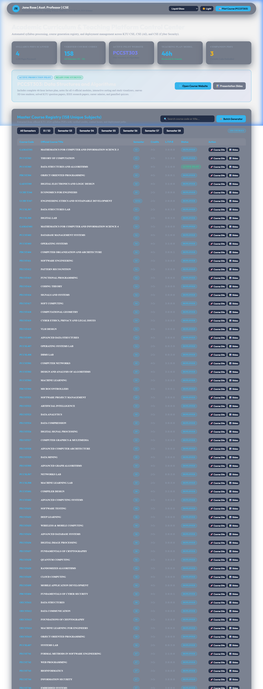
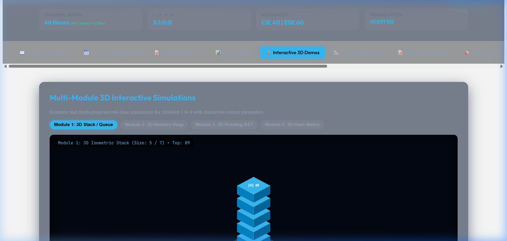
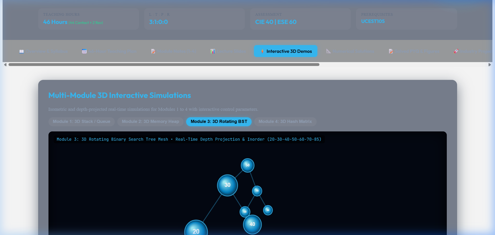
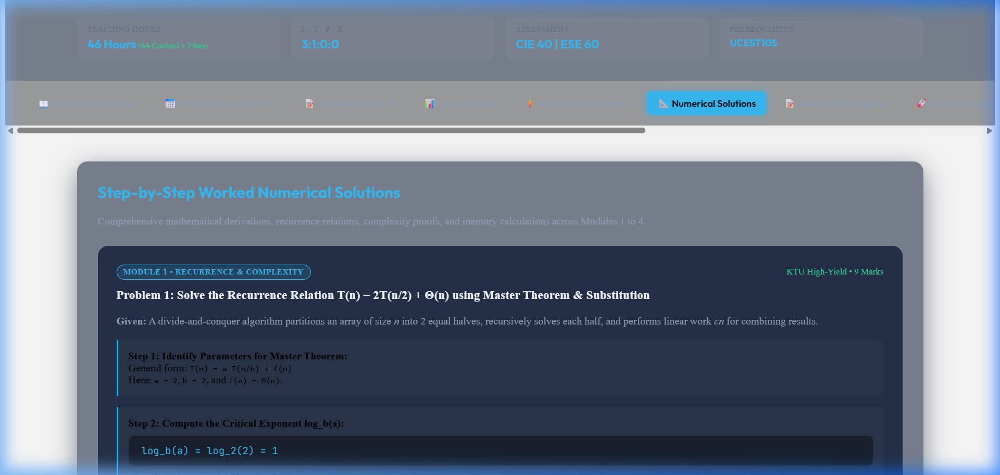
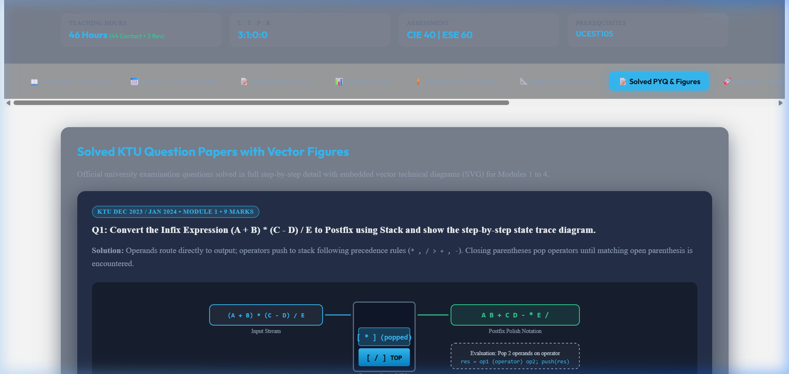
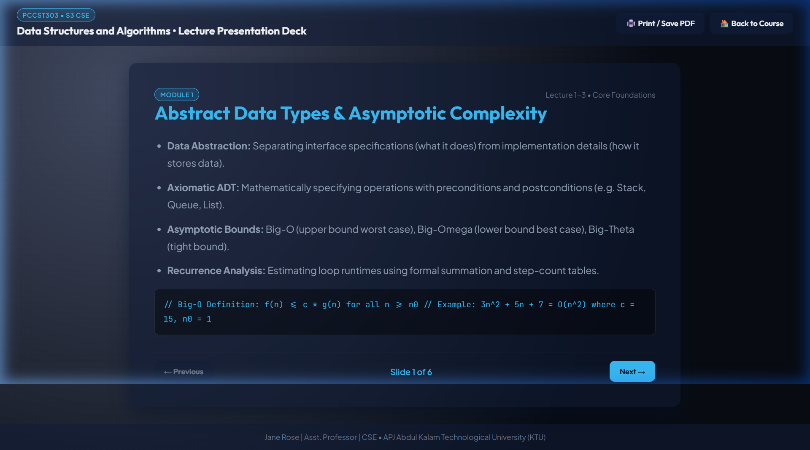
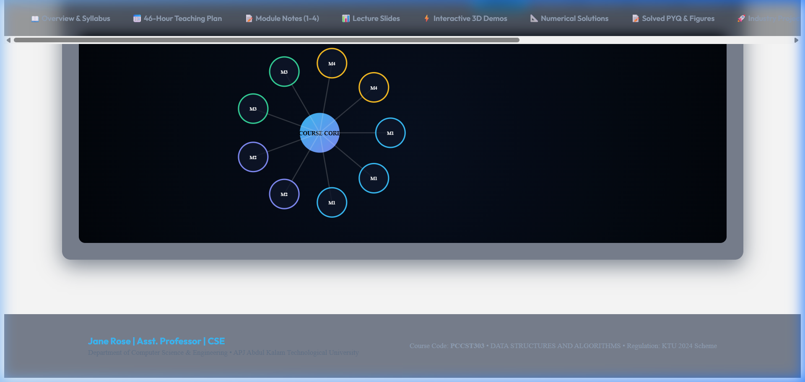

<div align="center">


# 🎓 KTU Automated Syllabus-to-Teaching-Website Platform
### Advanced Academic Learning Ecosystem • B.Tech 2024 Scheme
**Jane Rose** | Assistant Professor, Department of Computer Science & Engineering  
*APJ Abdul Kalam Technological University (KTU), Kerala, India*

<br>

[](https://ktu-teaching-platform.vercel.app)
[](https://github.com/Janeferdinant/ktu-teaching-platform)
[](https://ktu-teaching-platform.vercel.app)
[](https://ktu-teaching-platform.vercel.app/faculty-dashboard/)
[](https://github.com/Janeferdinant/ktu-teaching-platform)

<br>

**[🌐 Launch Live Platform](https://ktu-teaching-platform.vercel.app)** • **[📊 Faculty Control Dashboard](https://ktu-teaching-platform.vercel.app/faculty-dashboard/)** • **[⚡ Pilot Course (PCCST303)](https://ktu-teaching-platform.vercel.app/courses/PCCST303/)** • **[🖥️ Interactive Slide Deck](https://ktu-teaching-platform.vercel.app/courses/PCCST303/slides/)**

</div>

---

## 🌟 Executive Summary

The **KTU Automated Syllabus-to-Teaching-Website Platform** is a state-of-the-art educational infrastructure designed by **Jane Rose (Asst. Professor, CSE)**. It automatically analyzes, parses, and converts university curriculum syllabus documents into **158 dedicated, interactive, student-ready teaching websites**, each paired with a synchronized presentation deck, 46-hour structured teaching schedule, interactive 3D simulations, worked mathematical solutions, solved university exam papers with vector SVG figures, and a centralized faculty control dashboard.

---

## 📸 Visual Showcase & Platform Tour

### 1. Centralized Faculty Control Dashboard
A high-performance command center cataloging all 158 academic courses with real-time fuzzy search, semester/program filters, KPI metrics, and instant single-click launch.

<div align="center">
  
  <p><em>Figure 1: Centralized Faculty Dashboard featuring 158 course portals with Liquid Glass UI styling.</em></p>
</div>

---

### 2. Multi-Module 3D Interactive Visualizers & Sandboxes
Every course module is equipped with real-time depth-projected and isometric 3D canvas visualizers with interactive controls, HUD status updates, and algorithm sandboxes.

<div align="center">
  
  <p><em>Figure 2.1: Module 1 3D Isometric Stack Memory Simulation with real-time push/pop animations.</em></p>
</div>

<div align="center">
  
  <p><em>Figure 2.2: Module 3 3D Rotating Binary Search Tree Mesh with depth scaling and real-time ray casting.</em></p>
</div>

- **Module 1 Visualizer**: 3D Isometric Stack & Queue memory blocks with push/pop animation and overflow/underflow alerts.
- **Module 2 Visualizer**: 3D Dynamic Memory Allocation Heap blocks simulating First-Fit and Best-Fit segment placement with fragmentation indicators.
- **Module 3 Visualizer**: 3D Rotating Binary Search Tree / Graph mesh with real-time perspective depth projection and inorder traversal tracing.
- **Module 4 Visualizer**: 3D Hash Table Bucket Matrix with separate chaining slots and collision probing visualization.

---

### 3. Worked Mathematical Solutions & Formula Blocks
Rigorous mathematical derivations, recurrence relations, complexity proofs, and memory equations mapped directly to KTU examination evaluation rubrics.

<div align="center">
  
  <p><em>Figure 3: Worked mathematical derivations with parameter breakdowns and LaTeX-styled formula blocks.</em></p>
</div>

- **Module 1**: Master Theorem case analysis and recurrence relation substitution for $T(n) = 2T(n/2) + \Theta(n) \implies \Theta(n \log n)$; Sparse Matrix 3-tuple memory footprint ratio calculations.
- **Module 2**: External memory fragmentation ratio $ExtFrag = 1 - \frac{\text{MaxBlock}}{\text{TotalFree}}$; Doubly vs Singly Linked List memory footprint with 64-bit pointer alignment padding.
- **Module 3**: Binary Heap build-heap $O(n)$ summation convergence proof ($\sum_{h=0}^\infty \frac{h}{2^h} = 2$); BST tree height vs node count calculations.
- **Module 4**: Linear vs Quadratic vs Double Hashing probe sequence calculations; Expected unsuccessful search probes $E(U) = \frac{1}{1 - \alpha}$.

---

### 4. Solved KTU Exam Papers WITH Technical Vector SVG Figures
Official university examination questions solved in full step-by-step detail with crisp, responsive inline vector SVG diagrams (zero broken links).

<div align="center">
  
  <p><em>Figure 4: KTU 9-mark university question solutions with embedded responsive vector SVG diagrams.</em></p>
</div>

- **Figure 1.1 (Module 1)**: Stack postfix evaluation state trace and operator resolution flow diagram.
- **Figure 2.1 (Module 2)**: Doubly linked list 4-way pointer re-wiring diagram (`next` & `prev` node pointer updates).
- **Figure 3.1 (Module 3)**: Binary search tree 3-case node deletion (Leaf, single child bypass, and 2-child Inorder Successor replacement).
- **Figure 4.1 (Module 4)**: Hash collision linear probing cluster & separate chaining bucket linked list diagram.

---

### 5. Interactive Presentation Slide Decks
Dynamic fullscreen lecture presentation slides aligned with KTU syllabus modules, featuring keyboard arrow navigation, slide progress indicator, and clean print-to-PDF support.

<div align="center">
  
  <p><em>Figure 5: Fullscreen presentation deck with code snippets, syllabus badges, and print controls.</em></p>
</div>

---

### 6. Interactive Knowledge Graph & Gamified Quizzes
Explore interconnected core concepts, prerequisites, and Bloom's Taxonomy ratings with module filter pills and interactive click inspectors.

<div align="center">
  
  <p><em>Figure 6: Circular SVG concept knowledge graph with module filter pills and inspection panel.</em></p>
</div>

---

## 🎨 Liquid Glass Design System

The platform features an ultra-premium **Liquid Glass Design System** with 10 user-selectable visual themes, dark/light toggle, and persistent settings via `localStorage`:

1. **Liquid Glass** (Default dark cyberpunk glassmorphism)
2. **Frosted Glass** (High-blur frosted ice aesthetic)
3. **Aurora Glass** (Vibrant Northern Lights emerald/cyan gradient)
4. **Crystal Glass** (Prismatic high-refraction glass)
5. **Holographic Glass** (Iridescent spectral shimmer)
6. **Layered Translucent** (Clean multi-depth translucent sheets)
7. **Neumorphic Hybrid** (Soft shadows combined with glass borders)
8. **Sci-Fi Lab** (Deep-space HUD with neon accents)
9. **Light Academic** (Daylight university reading mode)
10. **High-Contrast Mode** (Accessible WCAG AAA compliance)

---

## 📅 46-Hour Reconciled Teaching Model

Every course incorporates a structured 46-lecture syllabus progression conforming to KTU B.Tech 2024 Scheme guidelines:
- **44 Contact Teaching Hours**: 4 Modules × 11 Contact Hours per module.
- **2 Revision / Exam Prep Hours**: Lecture 45 (Comprehensive Numerical Review) & Lecture 46 (Simulated 60-Mark University Model Exam).
- Each lecture specifies: Topic, Learning Outcome, Pedagogical Teaching Method, Board Work / Numericals, and Real-Life Industry Applications.

---

## 📂 Repository Architecture

```text
ktu-teaching-platform/
├── assets/
│   ├── hero_banner.jpg              # Ultra-wide 8K generated AI hero banner
│   └── screenshots/                 # Visual demonstration captures
├── courses/
│   ├── PCCST303/                    # Pilot Course: Data Structures & Algorithms
│   │   ├── notes/                   # Theoretical and practical notes
│   │   ├── slides/                  # Standalone slide deck (lecture_slides.html)
│   │   ├── teaching-plan/           # 46-hour structured syllabus plan JSON
│   │   └── website/                 # Dedicated course SPA (index.html, course.js)
│   └── [157 OTHER COURSES]/         # Dedicated directory per KTU course code
├── faculty-dashboard/
│   ├── index.html                   # Centralized liquid glass control dashboard
│   ├── dashboard.css                # Glass styling and grid layout
│   └── dashboard.js                 # Search, filter, and course launch engine
├── shared-components/
│   ├── course/
│   │   ├── course.css               # Unified styling for 3D HUD, numericals, figures
│   │   └── course.js                # 3D canvas renderers, quiz engine, knowledge graph
│   └── themes/
│       ├── liquid-glass.css         # 10 Selectable glass theme definitions
│       └── theme-switcher.js        # Dynamic theme persistence controller
├── registry/
│   ├── course_registry.json         # Master database of 158 verified courses
│   ├── course_registry.csv          # Spreadsheet export of courses
│   └── deployment_manifest.json     # Global course-to-URL route manifest
├── scripts/
│   └── build_all_courses.py         # Automated batch generator for all 158 courses
├── tests/
│   ├── test_full_platform.py        # 19 Integration & schema unit tests
│   ├── test_slides_routing.py       # Slide deck routing & print verification tests
│   └── test_module_features.py      # Verification of 3D, numericals & SVG figures
├── vercel.json                      # Vercel Edge CDN rewrite rules
└── server.js                        # Local preview & development server
```

---

## 🚀 Quick Start & Development

### 1. Prerequisites
- **Node.js** (v18+)
- **Python** (v3.10+) with `pymupdf` (optional, for PDF rebuilds)

### 2. Local Setup
```bash
# Clone the repository
git clone https://github.com/Janeferdinant/ktu-teaching-platform.git
cd ktu-teaching-platform

# Start the local development server
node server.js
```
*Access the platform at `http://localhost:5173`.*

### 3. Run Automated Verification Test Suite
```bash
# Verify all 158 course websites for 3D demos, numericals, SVG figures, and quizzes
py tests/test_module_features.py

# Run platform integration test suite (19 tests)
py tests/test_full_platform.py

# Run slide deck routing test suite (5 tests)
py tests/test_slides_routing.py
```

---

## 🚢 Production Deployment

### Vercel Global Edge CDN
The platform is deployed as a zero-cold-start static site on Vercel:
```bash
# Deploy to Vercel production
npx vercel deploy --prod --yes
```
*Live at: **[https://ktu-teaching-platform.vercel.app](https://ktu-teaching-platform.vercel.app)***

### GitHub Pages
Also synchronized to GitHub Pages:
*Live at: **[https://janeferdinant.github.io/ktu-teaching-platform/](https://janeferdinant.github.io/ktu-teaching-platform/)***

---

## 👩‍🏫 Academic Citation & Faculty Profile

**Platform Author & Architect:**  
**Jane Rose**  
Assistant Professor, Department of Computer Science & Engineering  
APJ Abdul Kalam Technological University (KTU), Kerala, India  

*Curriculum Framework: APJ Abdul Kalam Technological University B.Tech 2024 Scheme*  
*License: Academic Educational Use — Department of CSE*
